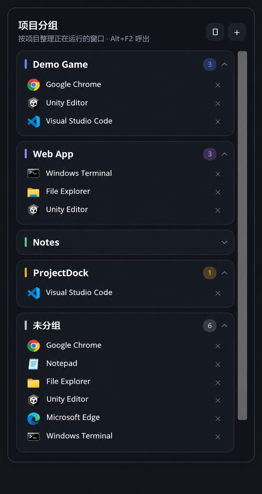
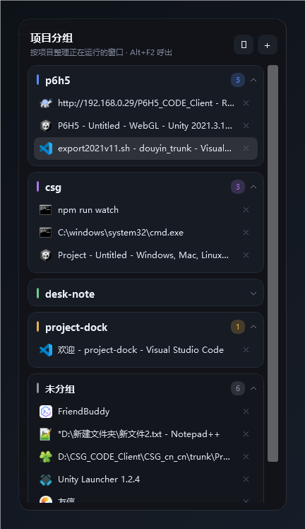
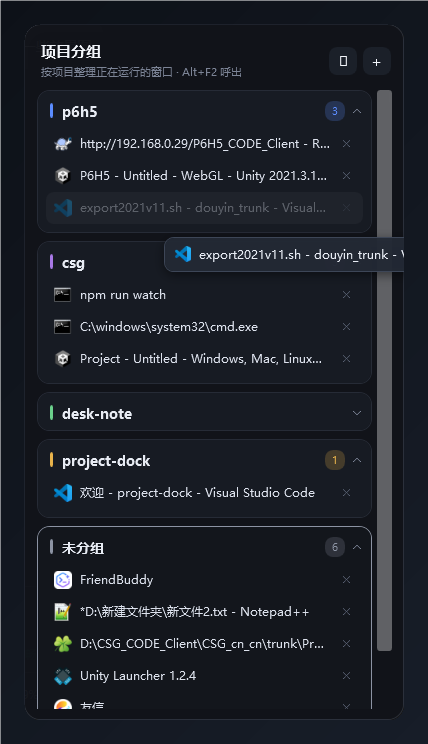
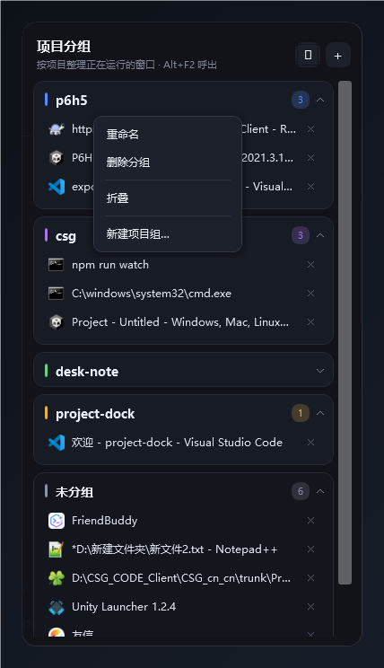
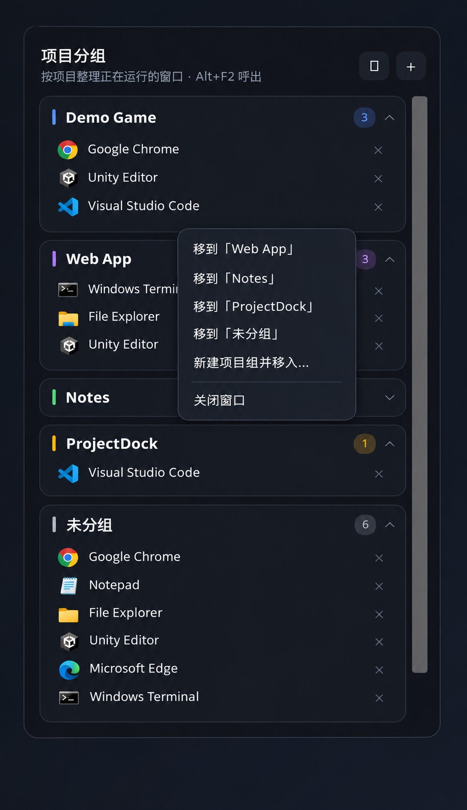
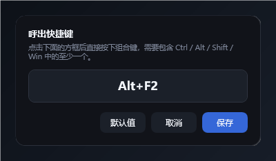

# ProjectDock

按项目给窗口分组的小工具：Unity、VSCode、资源管理器、终端、浏览器各归各位，
面板从屏幕右下角弹出，点一下就切过去。

**简体中文** | [English](#english)



---

## 中文

### 它解决什么问题

同时开三个项目时，任务栏会堆成一排看不出区别的图标：三个 Unity、五个 VSCode、
一堆文件夹和终端。想知道哪个窗口属于哪个项目，只能一个个点开看。

ProjectDock 把这些窗口按项目收进一个面板：`Demo Game` 一组、`Web App` 一组、
`Notes` 一组，剩下的进「未分组」。面板用完就收，任务栏原样不动。

### 效果

下方图片中的项目名和窗口标题均为演示内容，使用通用软件名称。

<p align="center">
  
  
</p>

左：当前前台窗口所在的分组会高亮，右侧数字是该组窗口数。
右：按住窗口行拖到别的分组，目标组高亮、松手即归组。

<p align="center">
  
  
</p>

左：分组右键可重命名、删除、折叠、新建项目组。
右：窗口右键可直接移到任意分组，或新建组并移入。

<p align="center">
  
</p>

快捷键可以随便换，点方框直接按组合键即可。

### 为什么是托盘图标

Win11 的任务栏删掉了 deskband 扩展点，第三方没法把自定义控件塞进任务栏本体；
注入 explorer 硬改任务栏不稳定，也不适合日常开发用。

所以做法是：**常驻托盘 + 点图标在任务栏正上方弹面板**。视觉上仍然贴着屏幕右下角，
一个图标就能呼出所有项目分组。

### 功能

- 托盘图标左键开合面板，右键菜单：打开面板 / 刷新 / 快捷键 / 开机启动 / 退出
- **全局快捷键**：默认 `Alt+F2`，按一下呼出，再按一下收起；可自定义
- 面板从工作区右下角向上弹出，高度按分组数量自适应，最多 720px，超出滚动
- **自动分组**：从窗口标题里识别项目名
  - VSCode / VSCode Insiders / Cursor / Windsurf：取标题中倒数第二段
  - Unity / Unity Hub：取 `项目名 - 场景 - Unity 版本` 里的项目名
  - 资源管理器：取非系统目录的文件夹名
  - Visual Studio：取 `解决方案 - Visual Studio` 里的解决方案名
  - 自动组最多 10 个，空组会自动回收
- **手动分组**：右键任意窗口 → 移到「某组」或新建组并移入
- **拖拽分组**：按住窗口行拖到别的分组即可移动；组内拖动可调顺序；目标组会高亮
- **拖拽排序**：按住分组标题上下拖动，可调整分组顺序
- 手动移动会写成规则（进程名 + 关键词），下次同类窗口自动归位，重启后仍然生效
- 分组右键：重命名、删除、折叠 / 展开、新建项目组
- 窗口行左键：切到前台并收起面板；右侧 `×`：关闭该窗口
- 当前前台窗口所在的分组会高亮
- 面板是弹窗式：点面板外任意位置（桌面、任务栏、其它窗口）立即收起
- 呼出时若前台被别的程序抢走，会重试一次拿回焦点；仍失败就自动收起，不会悬在屏幕上
- 单实例运行，重复启动只会唤出已有面板
- 中文深色界面，Per-Monitor V2 高 DPI

### 使用

1. 运行 `dist\ProjectDock.exe`，程序常驻托盘，不占任务栏。
2. 按 `Alt+F2` 或左键点托盘图标，面板在屏幕右下角向上弹出。
3. 点窗口行即可切换；`Esc` 或点面板外收起。
4. 想按项目整理：右键窗口 →「新建项目组并移入…」，输入项目名。
5. 也可以直接按住窗口行拖到目标分组上松手；拖到分组标题处会放到该组末尾。
6. 下次打开同项目的窗口，会自动落到这个组里。

### 快捷键

默认 `Alt+F2`，不会和 Windows 自带快捷键冲突。点面板右上角的 ⌨ 图标，
或托盘右键 →「快捷键…」，按下新的组合键即可
（至少包含 `Ctrl` / `Alt` / `Shift` / `Win` 中的一个）。

如果把快捷键设成 `Alt+F4`，它会被本程序接管——窗口不再被关闭，界面上会有橙色提示。
改完之后旧的组合键立刻恢复系统默认行为，新组合键全局生效。

### 配置与数据

分组与规则保存在：

```
%APPDATA%\ProjectDock\groups.json
```

快捷键等设置保存在：

```
%APPDATA%\ProjectDock\settings.json
```

写入采用临时文件 + 覆盖的方式，写坏不会影响已有配置；删掉文件即可恢复默认。
开机启动通过 `HKCU\Software\Microsoft\Windows\CurrentVersion\Run` 注册，
写在当前用户下、不需要管理员权限，托盘菜单里随时可以关。

### 从源码构建

需要 .NET 10 SDK（WPF + WinForms）。

```powershell
dotnet build src\ProjectDock.csproj -c Debug
dotnet run --project src\ProjectDock.csproj -- --show
```

发布单文件：

```powershell
.\publish.ps1                 # 依赖已安装的 .NET 10 桌面运行时，体积小
.\publish.ps1 -SelfContained  # 自带运行时，体积大，拷走即用
```

输出在 `dist\`，当前版本约 270 KB（framework-dependent）。

排查交互问题时可以设环境变量 `PROJECTDOCK_DEBUG=1` 启动，
面板开合与「点外部」判定会写到 `%TEMP%\pd-diag.log`；不设时完全不写日志。

### 技术备忘

- WPF / .NET 10，一个无边框窗口 + 托盘常驻，不注入 explorer、不改任务栏
- 全局快捷键与「点外部收起」都用低级钩子：键盘钩子常驻（只做按键匹配），
  鼠标钩子只在面板可见期间安装，收起立即卸载
- 分组规则 = 进程名 + 标题关键词；自动分组按各 IDE 的标题格式解析
- 单实例用命名 Mutex，二次启动只通过事件唤起已有面板

### 已知限制

- 任务栏本身不可定制，所以入口是托盘图标，不是任务栏按钮。
- 枚举的是顶层可见窗口：UWP / 商店应用、部分全屏游戏窗口可能不出现。
- 以管理员权限运行的窗口，需要本程序同样以管理员身份启动才能激活或关闭。
- 只做了单屏定位（取主屏工作区）；多屏时面板固定出现在主屏右下角。

---

## English

ProjectDock groups your open windows by project and keeps them one click away in the
system tray. Unity, VSCode, Explorer, terminals and browsers land under the project
they belong to; a panel slides up from the bottom-right corner and you jump straight
to the window you want.

### The problem

With three projects open, the taskbar turns into a row of indistinguishable icons:
three Unity windows, five VSCode windows, a pile of folders and terminals. The only
way to find out which window belongs to which project is to click through them.

ProjectDock collects them into one panel — a group per project, everything else under
"未分组" (ungrouped). The panel disappears when you are done; the taskbar stays as is.

### Screenshots

Project names and window titles in these images are examples using common software names.

<p align="center">
  
  
</p>

Left: the group owning the foreground window is highlighted, the badge shows how many
windows it holds. Right: drag a row onto another group — the target highlights and the
window moves on release.

<p align="center">
  
  
</p>

Left: right-click a group to rename, delete, collapse or create one.
Right: right-click a window to move it into any group, or create a group for it.

<p align="center">
  
</p>

The hotkey is fully configurable — click the box and press the combination.

### Why a tray icon

Windows 11 removed the taskbar deskband extension point, so third-party apps can no
longer host custom UI inside the taskbar itself. Patching explorer is fragile and not
worth it for a daily tool. ProjectDock therefore lives in the notification area and
opens its panel directly above the taskbar corner — visually the same place, without
touching the shell.

### Features

- Tray left click toggles the panel; right click: open / refresh / hotkey / startup / exit
- Global hotkey (default `Alt+F2`, customizable) toggles the panel
- Panel grows upward from the work-area corner, auto-sizes, scrolls past 720px
- Automatic grouping from window titles (VSCode, Cursor, Unity, Explorer, Visual Studio)
- Manual grouping: right-click a window, move it to a group or create one
- Drag a window row onto another group to move it, drag within a group to reorder,
  drag group headers to reorder the groups themselves
- Manual moves persist as rules (process name + keyword) and survive restarts
- Rename, delete, collapse groups; close or focus a single window
- The group owning the foreground window is highlighted
- Click anywhere outside the panel (desktop, taskbar, other windows) to dismiss it;
  if another app steals the foreground on open, focus is retried once, then the
  panel hides instead of floating around
- Single instance, dark UI, Per-Monitor V2 DPI aware

### Usage

1. Run `dist\ProjectDock.exe`. It stays in the notification area, not on the taskbar.
2. Press `Alt+F2` or left-click the tray icon to open the panel at the bottom right.
3. Click a row to switch to that window; `Esc` or a click outside closes the panel.
4. Right-click a window → "新建项目组并移入…" to create a project group for it.
5. Or drag the row onto an existing group and drop it.
6. Windows of the same project land in that group automatically next time.

### Hotkey

`Alt+F2` by default, which does not collide with any Windows shortcut. Click the ⌨
icon in the panel header or use the tray menu; the combination must contain at least
one of `Ctrl` / `Alt` / `Shift` / `Win`. Assigning `Alt+F4` makes ProjectDock take it
over — windows stop closing and the dialog warns you.

### Config

```
%APPDATA%\ProjectDock\groups.json     # groups and rules
%APPDATA%\ProjectDock\settings.json   # hotkey
```

Files are written atomically (temp file + replace) and are safe to delete.
Run-at-startup is a per-user `HKCU\...\Run` entry, no admin rights needed.

### Build

Requires the .NET 10 SDK (WPF + WinForms).

```powershell
dotnet build src\ProjectDock.csproj -c Debug
.\publish.ps1                 # framework-dependent single file
.\publish.ps1 -SelfContained  # self-contained single file
```

Output lands in `dist\` (~270 KB when framework-dependent). Set
`PROJECTDOCK_DEBUG=1` to log open/close and click-outside decisions to
`%TEMP%\pd-diag.log`; nothing is written otherwise.

### How it works

- WPF on .NET 10: one borderless window plus a tray icon, no explorer injection
- Both the global hotkey and click-outside detection use low-level hooks; the mouse
  hook is installed only while the panel is visible and removed as soon as it hides
- A grouping rule is "process name + title keyword"; automatic grouping parses the
  title format of each IDE
- Single instance via a named mutex; a second launch signals the running instance

### Known limitations

- The taskbar itself is not customizable, so the entry point is the tray icon.
- Only top-level visible windows are enumerated; UWP/store apps and some full-screen
  games may not show up.
- Windows running elevated can only be activated or closed if ProjectDock also runs
  elevated.
- Single-monitor positioning: the panel always appears on the primary monitor.

## 检测更新

右键系统托盘图标，选择 **帮助 → 检测更新**。程序会比较当前版本和本项目 GitHub 最新正式发布版；发现新版后可选择打开发布页下载。无正式发布版或网络失败时会显示提示。
